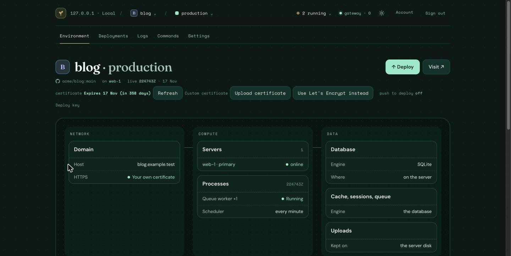
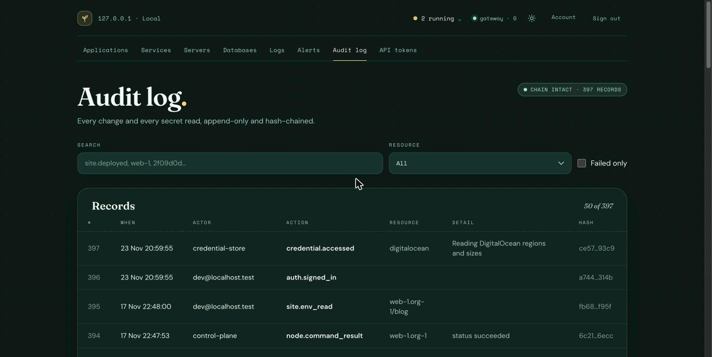
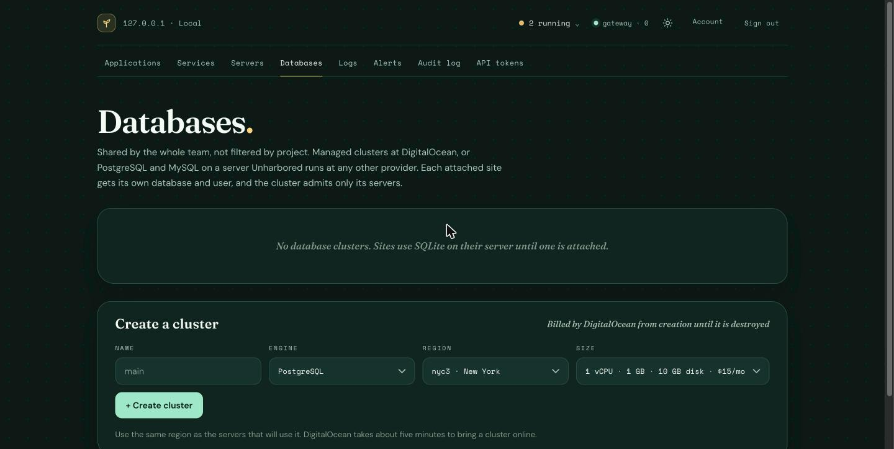

# Unharbored

A deployment and server management platform for DigitalOcean, combining
Forge's ownership model with Laravel Cloud's managed experience.

Servers live in the customer's own DigitalOcean account. We never hold a
usable SSH private key for them, never open an inbound port on them, and never
resell capacity. The platform provisions, configures, deploys, scales and
monitors; the infrastructure belongs to whoever pays DigitalOcean for it.

**Status: Phase 1 done in substance.** A console at `cp.example.com`
deploys real Laravel apps from GitHub to DigitalOcean Droplets or your own
servers, with HTTPS, workers, the scheduler, daemons and Reverb, push to
deploy, rollback and a hash-chained audit log. The management server is
rebuildable from this repository; see
[docs/management-server.md](docs/management-server.md).

See [ROADMAP.md](ROADMAP.md) for status.

## Screenshots

An application: its domain and certificate, the servers it runs on, its
processes, and where its data lives.



The audit log: every change and every secret read, append-only and
hash-chained, with a check that the chain is intact.



Databases: managed clusters at DigitalOcean, or PostgreSQL and MySQL on a
server Unharbored runs at any other provider.



## Why this exists

[FEATURE-COMPARISON.md](FEATURE-COMPARISON.md) maps roughly 60 features across
Laravel Forge and Laravel Cloud against what we target. The short version:

- **Forge** gives you root and your own cloud account, but has no autoscaling,
  no scale-to-zero, and does not do zero-downtime deploys across more than one
  server without a separate Envoyer subscription.
- **Cloud** gives you autoscaling, managed queues and preview environments, but
  takes the servers away entirely and only runs where it runs.

Nobody offers both. That gap is the product.

[PLAN.md](PLAN.md) is the architecture and the nine-phase roadmap.

## Repository layout

```
cmd/
  agent/            node agent binary, installed by cloud-init
  gateway/          holds agent sessions for the control plane
  conformance/      emits fixtures the control plane asserts against
control-plane/      Laravel control plane (PHP 8.4, Laravel 13)
  app/Lib/Vault/        envelope encryption for customer credentials
  app/Lib/Audit/        append-only, hash-chained audit log
  app/Lib/Resources/    resource state machine and orphan tracking
  app/Lib/DigitalOcean/ API client with per-tenant rate limiting
  app/Lib/Enrollment/   server half of the enrollment handshake
  app/Lib/Pki/          per-organisation certificate authority
  app/Lib/Cloud/        provisioning, cloud-init bootstrap, reconciliation
  app/Lib/Gateway/      client for the session gateway
  app/Lib/Operations/   long actions (deploy, install, upgrade) as staged, queued operations
  app/Lib/Sites/        sites and the deploy pipeline
  app/Lib/Servers/      server stack recipe, installs, agent upgrades, node removal
  app/Lib/GitHub/       per-organisation GitHub App: webhooks and clone tokens
internal/
  protocol/         wire format: envelopes, framing, message types
  pki/              organisation CA, node and server certificate issuance
  enroll/           single-use enrollment tokens and the handshake
  transport/        mTLS, session multiplexing, heartbeat, reconnect backoff
  recipe/           idempotent configuration engine and its wire format
  deploy/           atomic release directories, activation, rollback, pruning
  commands/         command argument and result payloads, shared by both ends
  agentcore/        the agent: enrollment, session loop, command handlers
  gateway/          session gateway: CA registry, mTLS listener, control plane API
  integration/      end-to-end tests over real TLS sockets
examples/
  demo-app/         Phase 1 deploy target: a Laravel app that makes a
                    half-broken deploy visible
docs/
  architecture.md   how the pieces fit together, and the main flows
  adr/              architecture decision records
  specs/            protocol and security specifications
scripts/
  test-linux.sh     run the agent suite on Linux from a Windows host, via WSL
  test-php.sh       run the control plane suite in an ext4 working directory
  test-race.sh      race detector on both platforms, with a stress mode
```

## Architecture in one page

The full map, with the main flows (enrollment, deploys, autoscaling), is in
[docs/architecture.md](docs/architecture.md).

Three planes:

**Control plane (ours).** Owns tenancy, credentials, desired state,
orchestration and audit. Never in the request path of a customer application.
Laravel 13 on PHP 8.4, under `control-plane/`. See
[ADR 0002](docs/adr/0002-control-plane-language.md).

**Data plane (the customer's DigitalOcean account).** Droplets, load
balancers, managed databases, Spaces, VPCs, firewalls.

**Session gateway (ours).** A small Go service that holds every agent
connection, because PHP-FPM serves a request and exits and cannot. It relays
commands and events and does nothing else. A node is placed in a tenant by the
CA that signed its certificate, never by anything the node claims. See
[ADR 0007](docs/adr/0007-session-gateway.md).

**Agent (on every Droplet).** A single static Go binary with no third-party
dependencies. It opens an outbound mTLS connection to the gateway and holds
it. Nothing listens on the node.

The direction of that connection is the central design decision. Forge drives
servers over inbound SSH, which means storing private keys that grant root on
every managed server and allow-listing inbound SSH from fixed addresses. The
agent model removes that entire class of risk. See
[docs/adr/0001-agent-not-ssh.md](docs/adr/0001-agent-not-ssh.md).

## Getting started

For the agent: Go 1.23 or later, and nothing else. It has no third-party
dependencies and `go.sum` does not exist, which is deliberate
([ADR 0003](docs/adr/0003-zero-dependency-agent.md)).

For the control plane: PHP 8.4 with sodium, openssl, mbstring and pdo_sqlite,
plus Composer.

```bash
git clone git@github.com:unharbored/unharbored.git
cd unharbored

go build ./... && go test ./...          # agent

cd control-plane && composer install   # required: phpseclib and symfony/yaml
                                       # are declared but may not be installed
php artisan vault:generate-key           # set the result as VAULT_MASTER_KEY
php artisan migrate && php artisan test  # control plane
```

### Run an agent against the reference control plane

Two terminals. First, the control plane:

```bash
mkdir -p /tmp/cm && go run ./cmd/cpd -out-dir /tmp/cm
```

It mints an organisation CA and an enrollment token, writes both to
`-out-dir`, and prints the exact agent command to run. Then:

```bash
go run ./cmd/agent \
  -state-dir /tmp/cm/agent-state \
  -sites-root /tmp/cm/sites \
  -enroll-url https://127.0.0.1:9444/enroll \
  -server-name control-plane.local \
  -ca-file /tmp/cm/ca.crt \
  -token-file /tmp/cm/enroll.token
```

The agent enrolls, the token is spent, and the connection becomes mutually
authenticated. In the control plane terminal, `nodes` lists it and
`exec <node> git --version` runs a command on it.

The reference control plane mints a fresh CA on every start, so agents must
re-enroll after it restarts. Delete the state directory to do that.

## Testing

```bash
go test ./...                      # agent
go test ./internal/integration/    # end-to-end over real TLS
bash scripts/test-linux.sh         # the agent suite on Linux, from Windows
bash scripts/test-php.sh           # the control plane suite
bash scripts/test-race.sh          # race detector, Windows and Linux
bash scripts/test-race.sh --stress # repeated runs, varied parallelism
bash scripts/live-enrollment.sh    # a real agent against the real control plane
bash scripts/live-full-loop.sh     # the whole stack: control plane, gateway, agent
```

**On Windows, use the scripts.** Both exist because the repository lives on
the Windows drive mount while the code runs on Linux, and in both cases
running in place is either wrong or unusably slow. `test-php.sh` takes a warm
run from 27 seconds to under one.

**On Windows, run `scripts/test-linux.sh` before trusting a green run.** The
agent targets Linux. On Windows, symlinks need elevation and POSIX permission
bits are not enforced, so 14 deploy tests and several others skip silently.
The suite looks green while the core of the deploy package never executes.

That is not hypothetical. The repeated-rollback bug fixed in `e25a503` was
invisible on Windows and failed on the first Linux run. The script
cross-compiles the test binaries and runs them under WSL; Go does not need to
be installed inside WSL.

Current state: **agent 165 passing and 0 skipped on Linux; control plane 140
passing.**

The race detector runs clean on both Windows and Linux, including under
stress. It needs cgo, so a C compiler is required: `choco install mingw` on
the host, and `gcc` plus Go inside WSL for the Linux pass.

## Operating it

```bash
cd control-plane

php artisan vault:generate-key         # set as VAULT_MASTER_KEY
php artisan cloud:connect org-1 --name "My Org"   # prompts for a DO token
php artisan cloud:reconcile            # compare tracked state against DigitalOcean
```

`cloud:reconcile` is the one to run on a schedule. It finds resources running
under our tag that we have no record of, which is the customer being billed
for something we can neither see nor manage, and nothing else in the system
would notice. It reports and never destroys. A pass that could not reach
DigitalOcean exits non-zero rather than reporting a clean sweep, because a
blind check that looks green is worse than a red one.

## Documentation

| Document | What it covers |
|---|---|
| [PLAN.md](PLAN.md) | Architecture, subsystem design, security model, nine-phase roadmap |
| [FEATURE-COMPARISON.md](FEATURE-COMPARISON.md) | Forge and Cloud feature matrix, our target, the four compromises |
| [ROADMAP.md](ROADMAP.md) | Phase status and what is next |
| [CONTRIBUTING.md](CONTRIBUTING.md) | Conventions, workflow, how to add a command or step type |
| [docs/self-hosting.md](docs/self-hosting.md) | Run your own control plane: from nothing to a first deployed application |
| [docs/architecture.md](docs/architecture.md) | How the pieces fit together as built |
| [docs/first-droplet.md](docs/first-droplet.md) | How to provision the first real Droplet, and what to do when it fails |
| [docs/management-server.md](docs/management-server.md) | The management server: what runs there, backups, rebuilding it |
| [docs/specs/protocol.md](docs/specs/protocol.md) | Wire protocol specification, written so any language can implement the server half |
| [docs/specs/security-model.md](docs/specs/security-model.md) | Trust boundaries, threat model, controls |
| [docs/adr/](docs/adr/) | Architecture decision records |

## Licence

Functional Source License 1.1, Apache 2.0 future licence (FSL-1.1-ALv2). Copyright 2026
Matt Coleman. Use it for your own business or personally, commercial use
included; offering it to others as a competing product or service is not
permitted. Each release becomes Apache 2.0 two years after it is published. See
[LICENSE](LICENSE).
